  

  
  
  

### ❯ about

Senior full-stack engineer in Oklahoma City. Five years building enterprise HR
and AI-assisted products: React and TypeScript on the front, GraphQL APIs in
PHP and C#, Go services underneath. I own the schema, the API and the
interface.

### ❯ building

**[Pull Up](https://github.com/davis-brown/pull-up)** — find live pickup
basketball. A map of courts showing who's playing right now, with geo-verified
check-ins and courts seeded from OpenStreetMap.
Go + PostGIS API, Expo/MapLibre app, deployed on Cloudflare.
[Try it →](https://pull-up.davisbrown.dev)

### ❯ stack

  
  
  
  
  
  
  
  
  

